# Awesome-3D-Avatar-Creation-Webgl-Mesh-Editing

<p align="center">
  
</p>

<p align="center">
  <a href="https://github.com/ishandutta2007/Awesome-Awesome-Awesome"></a>
  <a href="https://discord.gg/jc4xtF58Ve"></a>
  <a href="https://github.com/ishandutta2007/Awesome-3D-Avatar-Creation-Webgl-Mesh-Editing/stargazers"></a>
  <a href="https://github.com/ishandutta2007/Awesome-3D-Avatar-Creation-Webgl-Mesh-Editing/network/members"></a>
  <a href="https://github.com/ishandutta2007/Awesome-3D-Avatar-Creation-Webgl-Mesh-Editing/blob/main/LICENSE"></a>
  <a href="https://github.com/ishandutta2007"></a>
</p>

---

## 🌐 Overview & SEO Summary

A curated directory and developer resource index for **3D Avatar Creation**, **WebGL Mesh Editing**, **VRM/glTF Character Generators**, and **Conversational AI Digital Humans**. Whether constructing custom 3D web configurators with **Three.js**, morphing parametric facial topologies with **FLAME** and **SMPL-X**, rendering photorealistic 3D Gaussian Splats in the browser, or puppeteering VTubers in real time, this list brings together leading commercial SaaS solutions and battle-tested open-source repositories.

---

## 📑 Table of Contents
- [📊 Sector Overview & Market Dynamics](#-sector-overview--market-dynamics)
- [🏢 SaaS & Hosted Platforms](#-saas--hosted-platforms)
- [🔓 Open-Source GitHub Projects](#-open-source-github-projects)
- [🛠️ Architecture & Recommended Pipelines](#️-architecture--recommended-pipelines)
- [📈 Star History](#-star-history)
- [💖 Support & Sponsorship](#-support--sponsorship)
- [🤝 How to Contribute](#-how-to-contribute)
- [📜 License & Disclaimer](#-license--disclaimer)

---

## 📊 Sector Overview & Market Dynamics

The global **3D Avatar & Digital Human market is estimated at approximately $3.2B–$12.1B and is projected to expand past $8B–$125B+ by 2030** at an aggressive CAGR of 17%–35%, propelled by real-time WebGL/WebGPU graphics, generative AI facial rigging, virtual streaming, and spatial computing.

The sector exhibits **moderate-to-high fragmentation** across functional sub-segments:
- Foundational character generation and consumer avatar layers remain diversified across specialized niche creators (gaming, VR, enterprise VTubing, and conversational customer assistants) without a single monopoly.
- However, infrastructure consolidation is accelerating rapidly: category leaders are frequently acquired by mega-caps (e.g., *Ready Player Me* acquired by Netflix, *Loom.ai* acquired by Roblox), while foundational browser 3D graphics heavily converge around standard formats like **glTF 2.0** and **VRM**.

---

## 🏢 SaaS & Hosted Platforms

A benchmark of leading 3D character generator and digital human SaaS platforms.

> [!NOTE]  
> All platforms are sorted in **descending order by company scale** (Valuation or Market Capitalization / Enterprise Size).

| SaaS Product | Company Scale / Valuation | Starting Paid Tier Pricing | Free Tier / Trial Limits | Core Features & Target Use Case |
| :--- | :--- | :--- | :--- | :--- |
| 🤖 **[Character.ai](https://character.ai)** | **$1.00B** (Valuation peak; multi-billion IP license partnership) | **$4.99/mo** (c.ai+ Lite) or **$9.99/mo** (c.ai+) | **Free forever plan**: Unlimited standard chat messages, subject to standard queuing / peak wait times and ads. | Cloud conversational AI character suite with persona creation, real-time voice, and user-generated avatar bots. |
| 🦄 **[Genies](https://genies.com)** | **$1.00B** (Valuation unicorn; $250M+ raised) | **Free consumer tools**; B2B custom enterprise partnerships & virtual asset transactions | **Free forever plan**: Free personal avatar creation, styling, and basic customization via consumer app/SDKs. | Digital avatar technology ecosystem, customizable stylized 3D avatars, digital wearables, and brand integrations. |
| 🎮 **[Inworld AI](https://inworld.ai)** | **$500M** (Valuation; $117M+ raised; est. $11M–$35M ARR) | **$25.00/mo** (Creator plan; credits included) | **Free forever plan**: $0/mo on-demand tier includes ~70 mins TTS, 400 mins STT, and access to prototype studio. | Cloud AI character engine combining multimodal personality modeling, voice synthesis, and real-time WebGL avatar animation. |
| 🥽 **[VRChat (Creator Cloud)](https://vrchat.com)** | **$343M** (Valuation; $95M+ raised; est. $28M ARR) | **$9.99/mo** or **$99.99/yr** (VRChat+) | **Free forever plan**: Unlimited play and avatar creation/uploads; VRChat+ adds 300 avatar favorites and badges. | Social VR and spatial platform with cloud avatar distribution, PhysBones rigging, and custom shader pipelines. |
| 🧠 **[Soul Machines](https://soulmachines.com)** | **$250M–$500M** (Peak VC valuation; $135M+ raised; AppDirect portfolio) | **$12.99/mo** (Studio Basic plan) | **Free forever plan**: $0/mo includes avatar studio creator and custom templates (0 live conversation mins); 14-day free trial on Studio. | Autonomous Digital People platform delivering photorealistic, emotionally responsive WebGL avatars powered by neuro-behavioral AI. |
| 🎨 **[Reallusion Character Creator](https://reallusion.com)** | **$50M–$100M** (Est. Enterprise private valuation) | **$29.00/mo** (Subscription) or **$299.00** (Perpetual CC4 License) | **30-day fully functional free trial**: Access to character generator, rigging, and animation pipeline testing. | Commercial 3D character creation powerhouse with parametric morph sliders, skin shaders, and clothing simulation. |
| 🌐 **[Ready Player Me](https://readyplayer.me)** | **$72M+ Raised** (Acquired by Netflix; platform sunset Jan 2026) | **$0/mo** (Free developer tier historically; Studio quotes) | **Free forever plan**: Standard developer SDK, glTF/GLB avatar creator iframe, and standard asset library with zero base fees. | Cross-game 3D avatar platform and WebGL creator SDK enabling glTF/GLB avatars from selfies for Unity, Unreal, and Web. |
| 👤 **[Union Avatars](https://unionavatars.com)** | **€1.2M Seed** (Operations wound down mid-2025) | **Enterprise / Custom API pricing** | **Free forever plan**: Free selfie-to-3D avatar generation and basic GLB export during active operations. | Interoperable digital identity and realistic 3D avatar platform creating rigged characters for metaverse and Web3. |
| 📸 **[Avaturn](https://avaturn.me)** | **Early-stage / Seed** (Est. $5M–$15M valuation) | **$800.00/mo** (Pro plan with developer SDK access) | **Free forever plan**: Free browser generator and basic exports for personal non-commercial testing and evaluation. | Realistic 3D avatar creator turning smartphone selfies into fully rigged humanoid heads and bodies with ARKit blendshapes. |
| 📹 **[LoomieLive (Loom.ai)](https://loomai.com)** | **$5.9M Seed** (Acquired by Roblox; integrated into Roblox engine) | **Included with Roblox engine** (Formerly commercial B2B licensing) | **Discontinued standalone**: Technology integrated into Roblox platform for free avatar animation and face tracking. | Real-time 3D personalized avatar creation and voice/webcam facial puppeteering engine for live streaming and virtual worlds. |

---

## 🔓 Open-Source GitHub Projects

Curated list of open-source frameworks, WebGL character builders, VRM avatar engines, and parametric mesh editing toolkits.

> [!TIP]  
> All repositories are sorted in **descending order by GitHub star count**. The badge links directly to each repository's stargazers page.

| Repository | GitHub Stars | License | Description & Ecosystem Focus |
| :--- | :--- | :--- | :--- |
| 🌟 **[mrdoob/three.js](https://github.com/mrdoob/three.js)** | [](https://github.com/mrdoob/three.js/stargazers) | `MIT` | The industry-standard JavaScript 3D library for WebGL/WebGPU; foundational engine for BufferGeometry deformation, morph targets, bones, and skinning. |
| 🤸 **[yeemachine/kalidokit](https://github.com/yeemachine/kalidokit)** | [](https://github.com/yeemachine/kalidokit/stargazers) | `MIT` | Blendshape kinematic solver mapping MediaPipe and holistic face/hand/body tracking points directly to 3D VRM avatars and 2D Live2D rigs. |
| 💬 **[HumanAIGC-Engineering/OpenAvatarChat](https://github.com/HumanAIGC-Engineering/OpenAvatarChat)** | [](https://github.com/HumanAIGC-Engineering/OpenAvatarChat/stargazers) | `Apache-2.0` | Comprehensive open-source conversational AI avatar pipeline integrating speech recognition (ASR), LLM reasoning, TTS, and real-time facial lip-syncing. |
| 📦 **[vrm-c/UniVRM](https://github.com/vrm-c/UniVRM)** | [](https://github.com/vrm-c/UniVRM/stargazers) | `MIT` | Official Unity implementation for VRM: standard humanoid avatar format featuring SpringBone physics, MToon shaders, blendshape expressions, and glTF meta. |
| 🧬 **[vchoutas/smplx](https://github.com/vchoutas/smplx)** | [](https://github.com/vchoutas/smplx/stargazers) | `Software Copyright License` | Expressive parametric human body model with full-body joint kinematics, natural finger articulation, and expressive 3D facial topology. |
| ✂️ **[shinshin86/mesh-avatar-studio](https://github.com/shinshin86/mesh-avatar-studio)** | [](https://github.com/shinshin86/mesh-avatar-studio/stargazers) | `MIT` | Local mesh avatar editor and browser WebGL player that converts 2D illustrations into rigged, blinking, lip-syncing avatars with AI coding agent support. |
| ⚡ **[pixiv/three-vrm](https://github.com/pixiv/three-vrm)** | [](https://github.com/pixiv/three-vrm/stargazers) | `MIT` | Official Three.js library for loading, posing, animating, and applying spring-bone physics to VRM 0.x/1.0 humanoid 3D avatars natively in the browser. |
| 👁️ **[emilianavt/OpenSeeFace](https://github.com/emilianavt/OpenSeeFace)** | [](https://github.com/emilianavt/OpenSeeFace/stargazers) | `BSD-2-Clause` | Robust real-time facial landmark and gaze tracking software designed for driving VTuber avatars, VR rigs, and 3D character blendshapes via webcams. |
| 🗣️ **[met4citizen/TalkingHead](https://github.com/met4citizen/TalkingHead)** | [](https://github.com/met4citizen/TalkingHead/stargazers) | `MIT` | Seamless browser-based 3D avatar conversational agent class that animates Ready Player Me and custom glTF avatars with Web Audio real-time viseme lip-sync. |
| 🧍 **[makehumancommunity/makehuman](https://github.com/makehumancommunity/makehuman)** | [](https://github.com/makehumancommunity/makehuman/stargazers) | `AGPL-3.0` | Premier parametric open-source 3D human modeling application featuring 1,100+ anatomical morph targets, hair/clothing libraries, and CC0 character exports. |
| 🎙️ **[tegnike/aituber-kit](https://github.com/tegnike/aituber-kit)** | [](https://github.com/tegnike/aituber-kit/stargazers) | `MIT` | Production-ready web application for chatting with 3D VRM AI characters with built-in ElevenLabs/VOICEVOX audio, OpenAI/Claude LLMs, and YouTube streaming integration. |
| 🔮 **[aigc3d/LAM](https://github.com/aigc3d/LAM)** | [](https://github.com/aigc3d/LAM/stargazers) | `Apache-2.0` | Large Avatar Model: SIGGRAPH 2025 one-shot animatable 3D Gaussian head avatar framework with real-time WebGL rendering and interactive audio-driven SDK. |
| 🤖 **[pixiv/ChatVRM](https://github.com/pixiv/ChatVRM)** | [](https://github.com/pixiv/ChatVRM/stargazers) | `MIT` | Clean, open-source browser web demo by Pixiv enabling direct conversational chat with VRM 3D avatars using OpenAI LLM and Web Voice API speech synthesis. |
| 🔌 **[makehumancommunity/mpfb2](https://github.com/makehumancommunity/mpfb2)** | [](https://github.com/makehumancommunity/mpfb2/stargazers) | `AGPL-3.0` | MakeHuman Plugin for Blender: procedural human mesh creation, bone rigging, weight painting, and procedural skin/eye shading directly inside Blender. |
| ✍️ **[Human3DAIGC/Make-A-Character](https://github.com/Human3DAIGC/Make-A-Character)** | [](https://github.com/Human3DAIGC/Make-A-Character/stargazers) | `Apache-2.0` | Text-to-3D human character framework generating fully controllable, rigged, and standard animatable 3D human meshes from text prompts. |
| 🎮 **[V-Sekai/godot-vrm](https://github.com/V-Sekai/godot-vrm)** | [](https://github.com/V-Sekai/godot-vrm/stargazers) | `MIT` | Complete Godot Engine 4.x/3.x plugin for importing, exporting, and runtime animating VRM characters with humanoid retargeting and MToon shaders. |
| 🎨 **[M3-org/CharacterStudio](https://github.com/M3-org/CharacterStudio)** | [](https://github.com/M3-org/CharacterStudio/stargazers) | `MIT` | Web-based custom 3D avatar creator studio built on Three.js featuring modular trait assembly, texture atlas baking, draw-call optimization, and glTF/VRM export. |
| 🧍‍♂️ **[yiyuzhuang/IDOL](https://github.com/yiyuzhuang/IDOL)** | [](https://github.com/yiyuzhuang/IDOL/stargazers) | `Apache-2.0` | Instant photorealistic 3D human reconstruction pipeline generating animatable, SMPL-X aligned meshes and textures from single unconstrained photos. |
| 📺 **[shinshin86/aituber-onair](https://github.com/shinshin86/aituber-onair)** | [](https://github.com/shinshin86/aituber-onair/stargazers) | `MIT` | TypeScript toolkit for building Neuro-sama-style autonomous AI VTubers that speak, interact with live YouTube chat, and animate VRM characters. |
| 💻 **[makehuman-js/makehuman-js](https://github.com/makehuman-js/makehuman-js)** | [](https://github.com/makehuman-js/makehuman-js/stargazers) | `MIT` | JavaScript and WebGL library providing parametric 3D human mesh generation and real-time morph target sliders natively in the browser. |
| 📂 **[ToxSam/open-source-avatars](https://github.com/toxsam/open-source-avatars)** | [](https://github.com/ToxSam/open-source-avatars/stargazers) | `CC0-1.0` | Comprehensive community repository and web gallery cataloging 4,200+ CC0/permissively licensed VRM 3D avatars with built-in blendshape viewer. |
| 🧙 **[cadop/HumanGenerator](https://github.com/cadop/HumanGenerator)** | [](https://github.com/cadop/HumanGenerator/stargazers) | `AGPL-3.0` | Blender/NVIDIA Omniverse extension utilizing MakeHuman topology to generate realistic, rigged 3D human meshes for virtual simulation and VFX. |
| 📐 **[olatunde85/3d-gen](https://github.com/olatunde85/3d-gen)** | [](https://github.com/olatunde85/3d-gen/stargazers) | `MIT` | Self-hosted browser generator for customizable rigged and animated 3D human meshes with full clothing morphs and GLB/FBX export. |
| 🌌 **[myned-ai/gsplat-flame-avatar-renderer](https://github.com/myned-ai/gsplat-flame-avatar-renderer)** | [](https://github.com/myned-ai/gsplat-flame-avatar-renderer/stargazers) | `MIT` | WebGL and WebAssembly 3D Gaussian Splatting engine driven by FLAME blendshapes for photorealistic talking head avatars in real time. |
| 🧩 **[hirokazuniimoto/virtual-avatar-sdk](https://github.com/hirokazuniimoto/virtual-avatar-sdk)** | [](https://github.com/hirokazuniimoto/virtual-avatar-sdk/stargazers) | `MIT` | Minimalist web SDK providing an idiomatic JavaScript API for driving VRM facial expressions, emotional lip-sync, and automated blinking. |

---

## 🛠️ Architecture & Recommended Pipelines

Building a complete browser-based 3D avatar solution typically involves three interconnected architectural layers:

```
┌────────────────────────────────────────────────────────┐
│             1. Generation & Mesh Modeling              │
│    (MakeHuman • SMPL-X • M3 CharacterStudio • Blender)  │
└───────────────────────────┬────────────────────────────┘
                            │ (Exports glTF 2.0 / VRM)
                            ▼
┌────────────────────────────────────────────────────────┐
│           2. Real-Time WebGL / WebGPU Rendering        │
│          (Three.js • three-vrm • gsplat-flame)         │
└───────────────────────────┬────────────────────────────┘
                            │ (Drives blendshapes & bones)
                            ▼
┌────────────────────────────────────────────────────────┐
│            3. Animation, Vision & AI Layer             │
│    (KalidoKit • OpenSeeFace • TalkingHead • LLM/TTS)   │
└────────────────────────────────────────────────────────┘
```

1. **Procedural Assembly Pipeline**: Combine `M3-org/CharacterStudio` or `makehuman-js` with `three-vrm` to let users assemble hairstyles, outfits, and morph shapes in WebGL.
2. **Conversational AI VTuber Pipeline**: Couple `pixiv/ChatVRM` or `tegnike/aituber-kit` with `met4citizen/TalkingHead` and ElevenLabs / Web Speech API for real-time speech and lipsyncing.
3. **Webcam Motion Tracking Pipeline**: Connect `emilianavt/OpenSeeFace` or `yeemachine/kalidokit` with MediaPipe to track user facial expressions and stream them into VRM blendshapes with zero latency.

---

## 📈 Star History

[](https://www.star-history.com/#ishandutta2007/Awesome-3D-Avatar-Creation-Webgl-Mesh-Editing&type=date&legend=top-left)

---

## 💖 Support & Sponsorship

If you found this curated ecosystem directory helpful for your projects, research, or development workflows, consider supporting the maintenance of this repository!

- ⭐ **Star this repository** to help other developers discover it
- 🍴 **Fork and contribute** new open-source projects or SaaS updates
- ☕ **Buy me a coffee / Sponsor**: Support ongoing maintenance on the [GitHub Sponsors Dashboard](https://github.com/sponsors/ishandutta2007)

Thank you to all community contributors and developers building open 3D standards!

---

## 🤝 How to Contribute

1. Fork this repository.
2. Add your SaaS product or open-source repo into `README.md` maintaining table sorting:
   - **SaaS**: Sorted descending by company scale/valuation. Must include specific tier pricing and exact free tier/trial limits.
   - **Open-Source**: Sorted descending by GitHub star count with shields.io white social badge.
3. Provide an accurate 1–2 sentence description highlighting technical capabilities.
4. Submit a Pull Request with a clear summary.

---

## 📜 License & Disclaimer

- Distributed under the **MIT License**.
- Product trademarks and logos belong to their respective corporate owners.
- Academic body models (such as SMPL-X and FLAME) have distinct non-commercial licensing terms; verify licenses prior to enterprise deployment.
